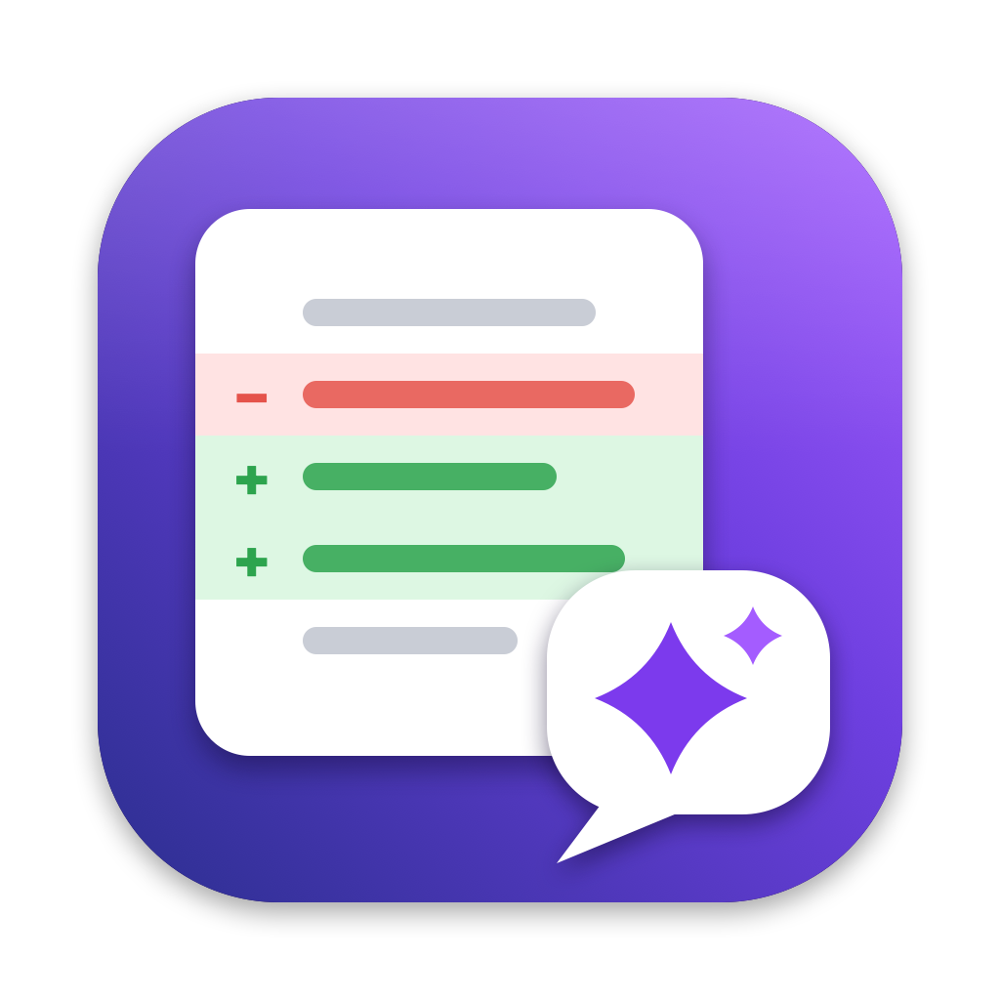
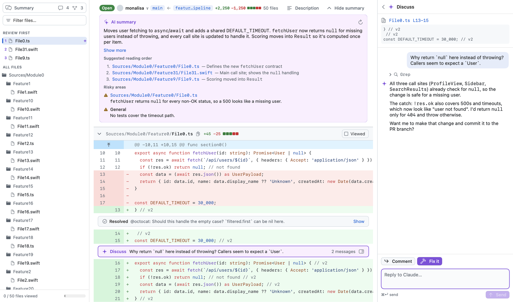
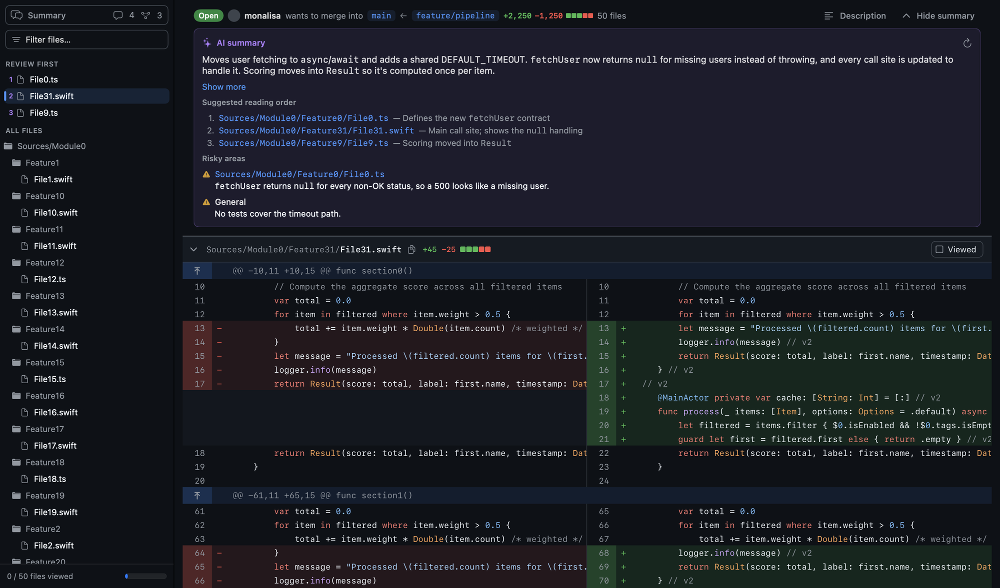
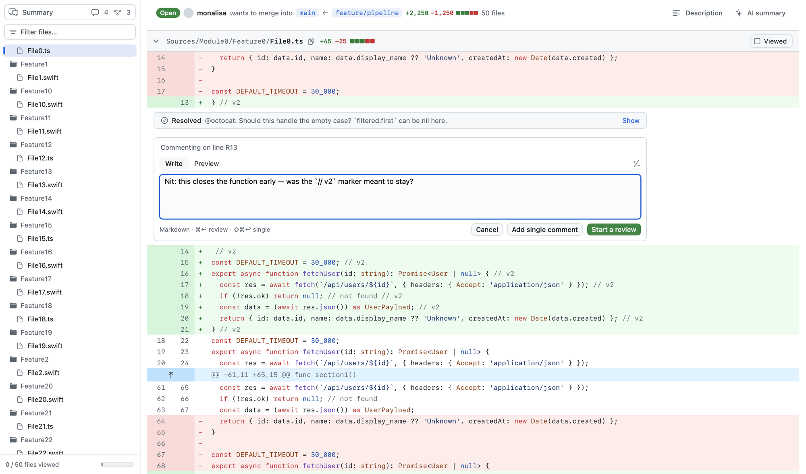
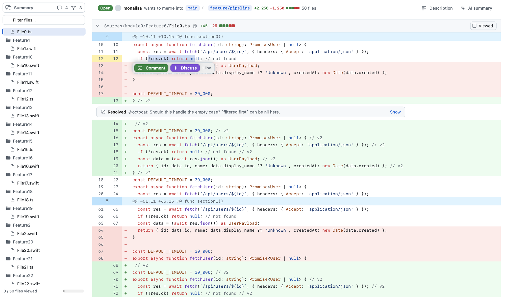
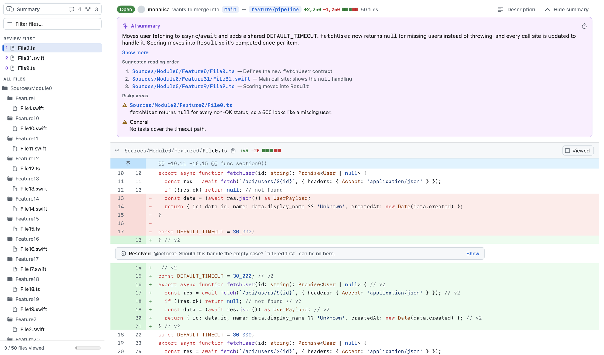
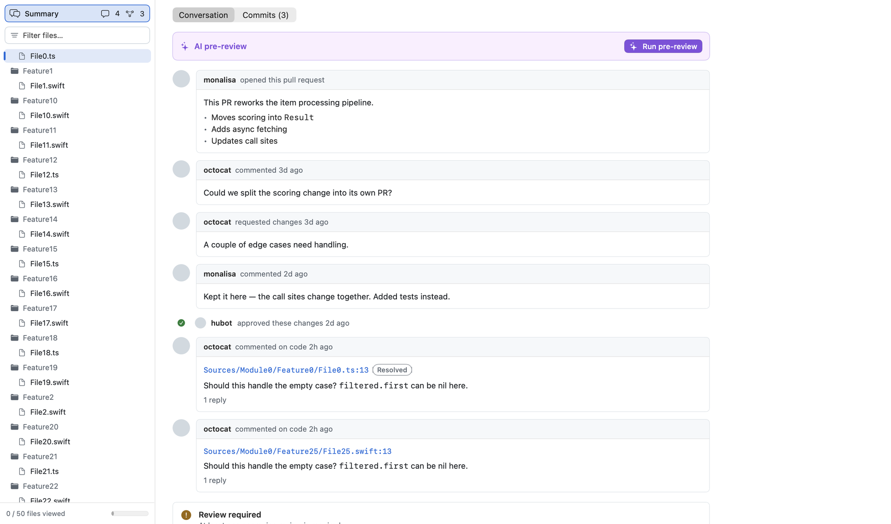

<p align="center">
  
</p>

<h1 align="center">Review Buddy</h1>

<p align="center">
  A native macOS app for reviewing GitHub pull requests, with Claude as your review partner.<br>
  <a href="https://github.com/dvlkv/review-buddy/releases/latest"><b>Download the latest release</b></a>
</p>

<p align="center">
  
</p>

Review Buddy looks and works like GitHub's "Files changed" tab, but it's a fast native app,
and it has Claude built in. Select some code and either **Comment** (a normal GitHub review
comment) or **Discuss** it privately with a Claude agent that has the PR checked out. The agent
can read the rest of the codebase, answer questions, and fix the code for you.

## Features

### A fast, GitHub-style diff

- Unified and split views, syntax highlighting, and expandable context.
- A file tree, "Viewed" checkboxes that sync with GitHub, and collapsible files.
- Diffs with thousands of files scroll smoothly: the diff is drawn natively, not in a web view.
- Large PRs that GitHub won't send as one diff are built from a local checkout instead.



### Review like on GitHub

- Comment on a line or a range by clicking or dragging the line numbers, or the **+** button.
- **Add single comment** posts right away. **Start a review** collects comments into a pending
  review that you submit as Comment, Approve or Request changes.
- Reply to threads, resolve them, edit or delete your comments, and insert suggestions.



### Select text, then Comment or Discuss

- Select part of a line by dragging, or double-click to select a word, like in a text editor.
- A **Comment / Discuss** bar appears next to the cursor.



### Discuss with Claude

- A private conversation about the selected code, shown in a side panel and marked inline in
  the diff. Nothing is posted to GitHub.
- Claude runs in a git worktree of the PR, so it can search and read the whole repository.
- **Fix it** has Claude change the code and commit to a local branch. You review the commits,
  then push them to the PR branch. Review Buddy never force-pushes.
- **Comment** turns the conclusion into a draft GitHub comment that you can edit before posting.

### AI summary and reading order

- A short summary of the PR, the risky areas, and a suggested reading order.
- The suggested files move to the top of the diff and the file tree under **Review first**.
  Right-click a file to change the order; it's saved per PR.
- **AI pre-review** runs a full first pass and lists findings that you can turn into comments.



### Summary screen

The **Summary** row above the file tree opens the PR's overview, like GitHub's Conversation tab:

- The conversation timeline (comments, reviews, threads) and the list of commits.
- Merge readiness: review status, checks with links to their logs, and conflicts.
- **Merge**, with the methods the repository allows, an admin "bypass rules" option, and a
  confirmation step.
- **Close / Reopen** the pull request, and a box for leaving a PR comment.



### Stays up to date

- The inbox lists PRs waiting for your review and your own PRs, and refreshes automatically.
- When someone pushes to the open PR, a bar offers **Refresh**. Refresh reloads the diff and
  fast-forwards the local checkout, as long as that doesn't discard your local commits or
  uncommitted changes.

## Install

1. Download `ReviewBuddy-<version>.zip` from the
   [latest release](https://github.com/dvlkv/review-buddy/releases/latest) and unzip it.
2. Move **ReviewBuddy.app** to Applications.
3. The app isn't notarized yet. The first time, right-click it and choose **Open**, or run:
   ```sh
   xattr -dr com.apple.quarantine /Applications/ReviewBuddy.app
   ```

### Requirements

- macOS 26 on Apple silicon.
- [GitHub CLI](https://cli.github.com), signed in with `gh auth login`. Alternatively, enter a
  personal access token in Settings.
- [Claude Code](https://claude.com/claude-code) (`claude`) for Discuss, the AI summary and the
  pre-review. The rest of the app works without it.

Claude Code runs locally under your own account. Review Buddy has no server, and talks only to
GitHub and to the `claude` process on your Mac.

## Keyboard

| Key | Action | Key | Action |
|---|---|---|---|
| `j` / `k` | next / previous file | `c` | comment on selection |
| `n` / `p` | next / previous hunk | `d` | discuss selection with Claude |
| `]` / `[` | next / previous thread | `v` | toggle viewed |
| `s` | split / unified | `x` | collapse file |
| `⌘R` | refresh the PR | `⌘L` | open PR by URL |
| `⌘K` | command palette | `⌘\` | toggle Discuss panel |
| `⌃⌘S` | toggle inbox sidebar | `⌘↩` / `⇧⌘↩` | submit to review / single comment |

## Build from source

Requires Xcode 26 (Swift 6.2 or later).

```sh
Scripts/bundle.sh release            # → build/ReviewBuddy.app
open build/ReviewBuddy.app
open build/ReviewBuddy.app --args --open https://github.com/owner/repo/pull/123
```

Try it without a GitHub account or network, using a generated in-memory PR:

```sh
build/ReviewBuddy.app/Contents/MacOS/ReviewBuddy --synthetic small   # or large / huge (2,000 files)
```

Run the tests:

```sh
swift test                                    # Core + UI tests
swift test -c release -Xswiftc -enable-testing  # also in release mode
Scripts/perf-check.sh                         # scripted UI performance run against budgets
```

The app icon is drawn by `Scripts/make-icon.swift`, which writes `Resources/AppIcon.icns`.

## Project layout

- `Sources/ReviewBuddyCore`: diff parsing and layout, syntax highlighting, the GitHub client,
  git worktrees, the Claude stream-json session, and persistence. No AppKit.
- `Sources/ReviewBuddyUI`: the stores (`PRStore`, `DiscussController`, `InboxStore`), the diff
  canvas, and the SwiftUI views.
- `Sources/ReviewBuddy`: the app entry point.

See [SPEC.md](SPEC.md) for the design and [PERF.md](PERF.md) for the performance work.
